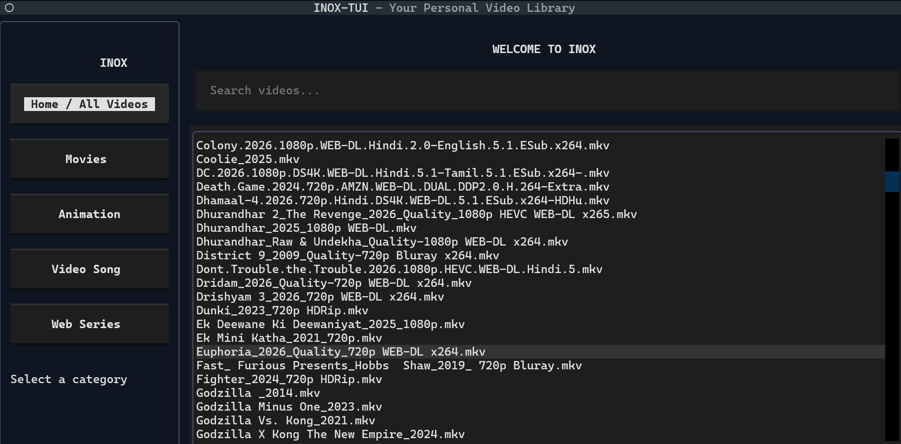

# INOX-TUI Community

A terminal-based personal video library that streams videos directly from Google Drive using VLC Media Player.

INOX-TUI lets you browse your Google Drive video collection, organise videos by category, search by filename and play videos without downloading the entire file.
## Screenshot


## Features

- Browse all videos from Google Drive.
- Four categories: Movies, Animation, Video Songs and Web Series.
- Search videos by filename.
- Stream videos directly from Google Drive.
- VLC Media Player integration.
- Video seeking support through HTTP Range streaming.
- Personal Google Drive authentication.
- Private configuration stored locally on each user's computer.

## Requirements

- Windows 10 or Windows 11
- Python 3.10 or newer
- VLC Media Player
- Google account
- Internet connection

## Installation

### 1. Download INOX-TUI

Download this repository using the GitHub Code → Download ZIP option.

Extract the ZIP file to a folder on your computer.

### 2. Install Python packages

Open Command Prompt inside the extracted INOX-TUI folder and run:

```bash
py -m pip install -r requirements.txt
```

### 3. Configure Google Drive API

Each user must configure their own Google Drive access.

1. Visit https://console.cloud.google.com/
2. Create a Google Cloud project.
3. Enable the Google Drive API.
4. Configure the OAuth consent screen.
5. If the application is in Testing mode, add your Google account as a test user.
6. Create OAuth credentials.
7. Select Desktop app as the application type.
8. Download the OAuth credentials JSON file.
9. Rename the downloaded file to `credentials.json`.
10. Place it inside the INOX-TUI folder.

Do not share your credentials file.

### 4. Connect Google Drive

Run:

```bash
py inox_drive_test.py
```

Sign in with your Google account and follow the instructions.

Select your four Google Drive folders when prompted:

- Movies
- Animation
- Video song
- Web_Series

The setup program creates:

- `token.json`
- `config.json`

These files are personal and must not be uploaded to GitHub.

### 5. Start the streaming server

Open a Command Prompt in the INOX-TUI folder and run:

```bash
py drive_stream_server.py
```

Keep this window open while using INOX-TUI.

### 6. Start INOX-TUI

Open another Command Prompt in the same folder and run:

```bash
py inox_tui.py
```

Enjoy your personal Google Drive video library!

## Project Files

| File | Purpose |
|---|---|
| `inox_tui.py` | Main terminal application |
| `drive_stream_server.py` | Google Drive video streaming server |
| `inox_drive_test.py` | First-time Google Drive setup |
| `config.example.json` | Example folder configuration |
| `requirements.txt` | Python dependencies |
| `.gitignore` | Protects personal files from Git uploads |

## Security and Privacy

- Every user must use their own Google account.
- Every user must create their own Google OAuth credentials.
- Never upload `credentials.json`, `token.json` or `config.json`.
- INOX-TUI uses Google Drive read-only access.
- The streaming server runs locally on `127.0.0.1`.

## Disclaimer

INOX-TUI is an independent community project and is not affiliated with Google or VideoLAN.

Users are responsible for ensuring that they have permission to access and stream the videos stored in their Google Drive.

## License

This project is distributed under the MIT License.
